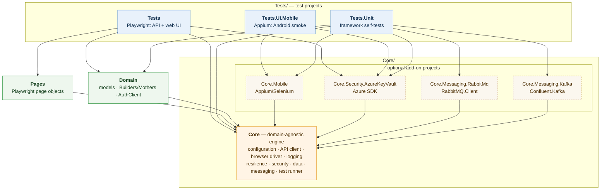
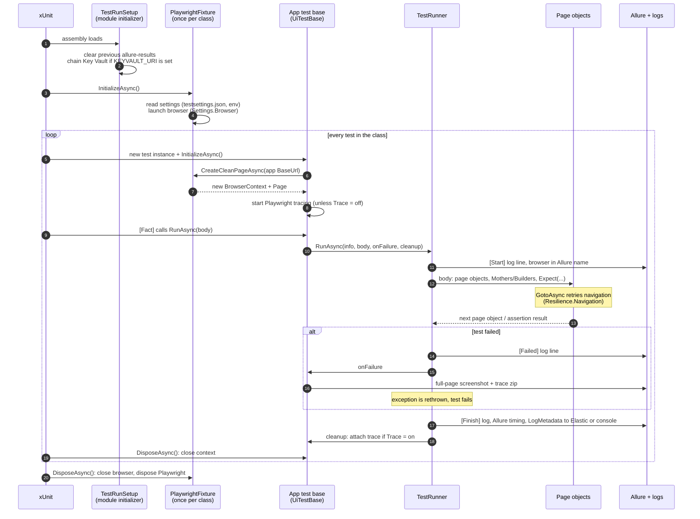
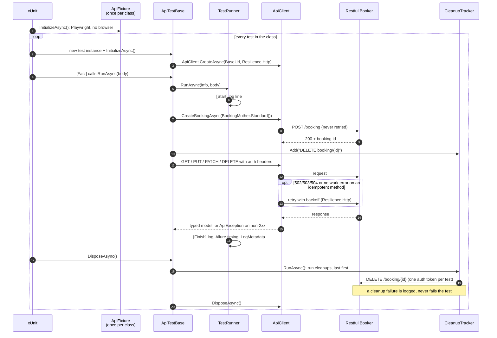
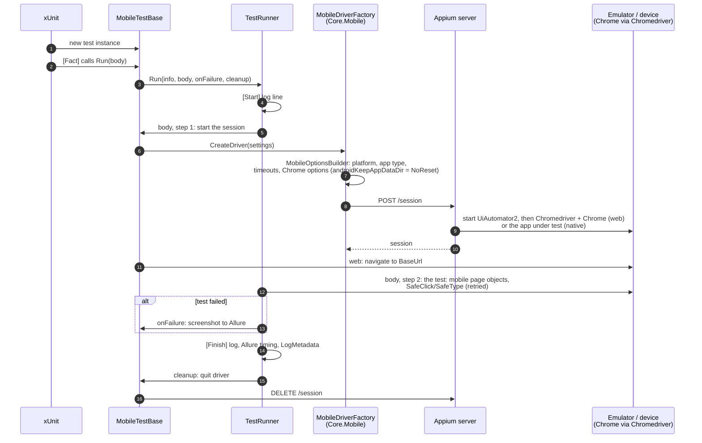
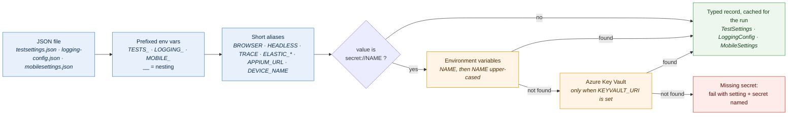
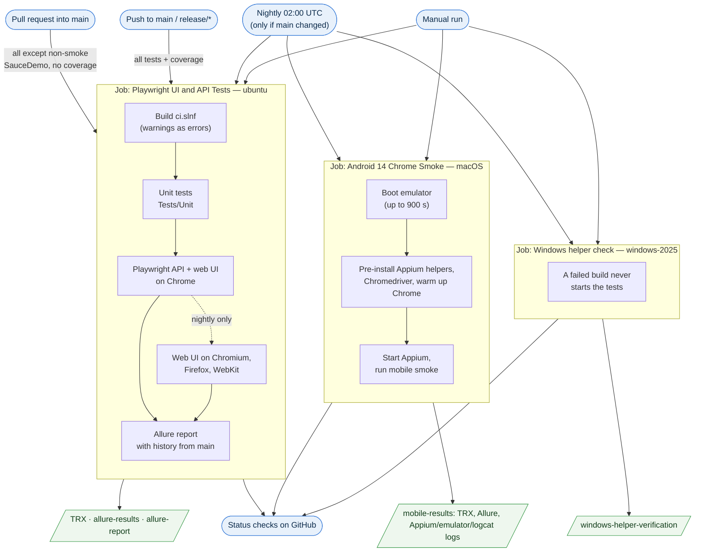

# Flow Diagrams

How control and data move through the framework, drawn with [Mermaid](https://mermaid.js.org/) so GitHub renders them and they change in the same pull request as the code. The text reference for each part is in [ARCHITECTURE.md](ARCHITECTURE.md); mobile details are in [MOBILE_ARCHITECTURE.md](MOBILE_ARCHITECTURE.md).

1. [Projects and dependencies](#1-projects-and-dependencies)
2. [A web UI test run](#2-a-web-ui-test-run)
3. [An API test run](#3-an-api-test-run)
4. [A mobile test run](#4-a-mobile-test-run)
5. [Settings and secrets](#5-settings-and-secrets)
6. [CI pipeline](#6-ci-pipeline)

To edit a diagram, paste it into the [Mermaid Live Editor](https://mermaid.live/) or use an editor with a Mermaid preview, then copy it back.

---

## 1. Projects and dependencies

Arrows point from a project to the project it references. Nothing references the test projects, and `Core` references none of the others (enforced by `Tests/Unit/Architecture/CoreBoundaryTests`). The add-ons live inside `Core/` but are separate projects, so their packages reach only the suites that use them.

---

## 2. A web UI test run

One test class (for example `CheckoutFlowTests`) from start to finish. The browser is launched once per class; every test gets a fresh context and page. `TestRunner` (in `Core`) is the same for every suite.

---

## 3. An API test run

API tests share one Playwright instance per class (no browser). Retries apply only to idempotent methods (GET, HEAD, OPTIONS, PUT, DELETE, TRACE) on 502/503/504 or network errors; a POST is never retried. Everything a test creates is registered for cleanup and removed after the test, last first.

---

## 4. A mobile test run

The Android suite runs against an Appium server and an emulator or device. Settings come from `mobilesettings.json` (`MOBILE_*` env vars override). In CI, `scripts/unix/run_mobile_ci.sh` prepares the emulator, Chromedriver and Chrome before the tests start.

---

## 5. Settings and secrets

Every settings record is loaded the same way by `SettingsLoader` and cached for the run. Later sources override earlier ones. Any value of the form `secret://NAME` is then resolved through `SettingsLoader.SecretProvider`.

---

## 6. CI pipeline

GitHub is the source; Azure Pipelines (`azure-pipelines.yml`) runs the builds and reports back as GitHub checks. There is one parallel job, so jobs queue one after another.

