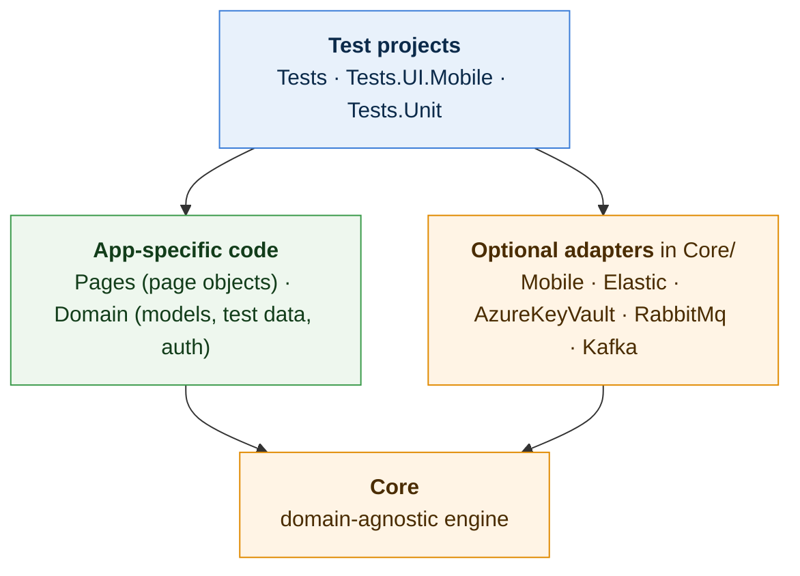
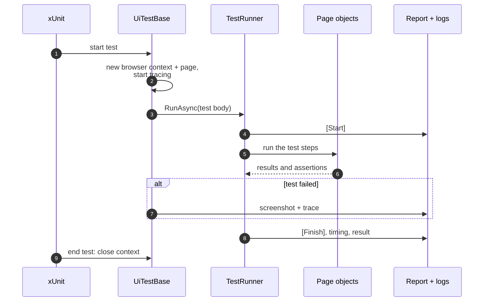
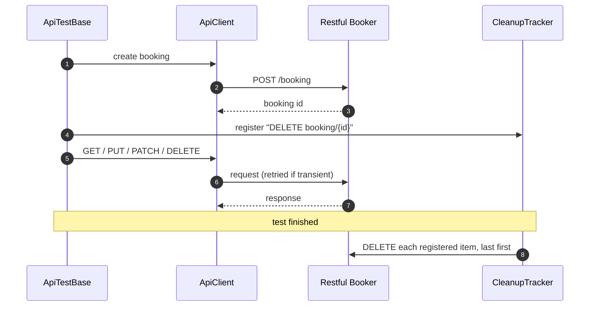
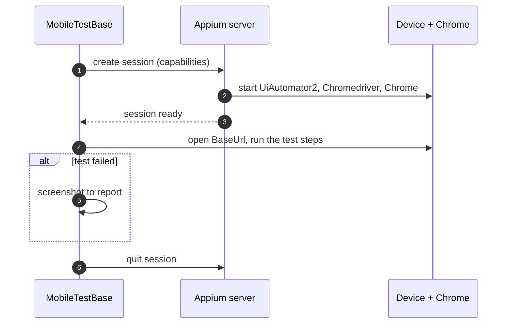
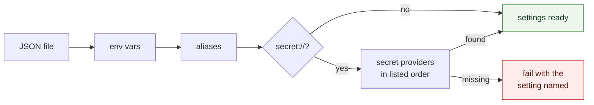
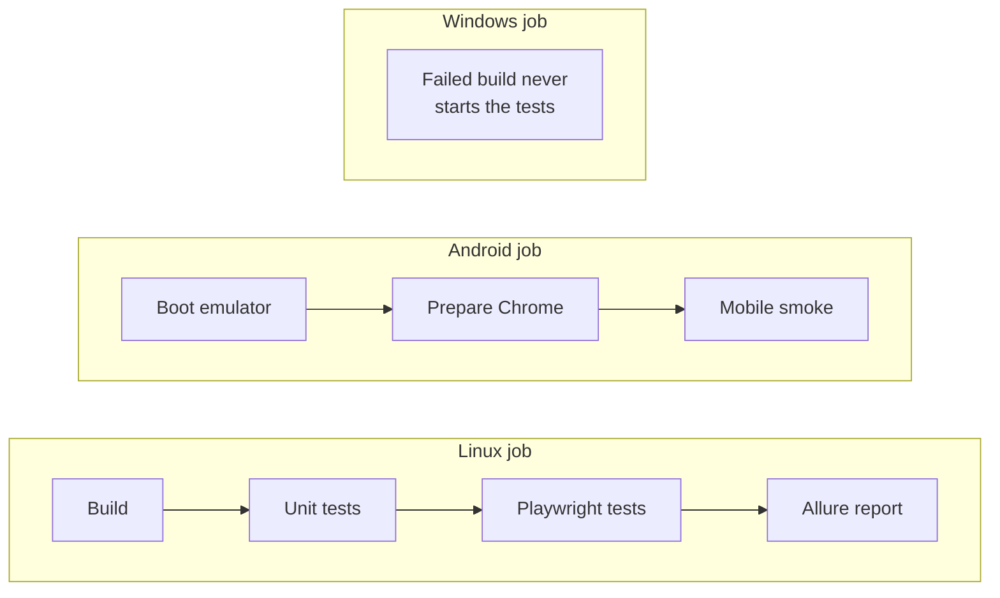

# Flow Diagrams

How control and data move through the framework, drawn with [Mermaid](https://mermaid.js.org/) so GitHub renders them and they change in the same pull request as the code. Each diagram shows one idea and only the main path; the tables under them carry the details. The text reference is [ARCHITECTURE.md](ARCHITECTURE.md); mobile details are in [MOBILE_ARCHITECTURE.md](MOBILE_ARCHITECTURE.md).

1. [Projects and layers](#1-projects-and-layers)
2. [A web UI test run](#2-a-web-ui-test-run)
3. [An API test run](#3-an-api-test-run)
4. [A mobile test run](#4-a-mobile-test-run)
5. [Settings and secrets](#5-settings-and-secrets)
6. [CI pipeline](#6-ci-pipeline)

To edit a diagram, paste it into the [Mermaid Live Editor](https://mermaid.live/) or use an editor with a Mermaid preview, then copy it back. Keep them small: one idea per diagram, no more than about eight boxes, and one arrow per group rather than one per project.

---

## 1. Projects and layers

Read top to bottom: each layer uses only the layers below it. `Core` uses none of the others (enforced by `Tests/Unit/Architecture/CoreBoundaryTests`).

Exact references:

| Project | Uses |
|---|---|
| `Tests` (Playwright API + web UI) | `Pages`, `Domain`, `Core`, `Core.Logging.Elastic`, `Core.Security.AzureKeyVault` |
| `Tests.UI.Mobile` (Appium) | `Core.Mobile`, `Core.Logging.Elastic`, `Core.Security.AzureKeyVault` |
| `Tests.Unit` (framework self-tests) | `Core`, `Domain` and every add-on, so it can test them |
| `Pages`, `Domain` | `Core` |
| `Core.Mobile`, `Core.Logging.Elastic`, `Core.Security.AzureKeyVault`, `Core.Messaging.RabbitMq`, `Core.Messaging.Kafka` | `Core` |

---

## 2. A web UI test run

One test from start to finish. The browser is launched once per test class; each test gets a fresh context and page.

| Step | Detail |
|---|---|
| Before the first test | `TestRunSetup` clears old Allure results and calls `Framework.Configure` with the adapters' plugins (providers chosen in `providers.json`); `PlaywrightFixture` reads `testsettings.json` and launches the browser once per class. |
| New context + page | Fresh cookies and storage for every test; tracing is on unless `Trace` is `off`. |
| Test steps | Page objects, Mothers/Builders and `Expect(...)`; `GotoAsync` retries navigation (`Resilience.Navigation`). |
| Test failed | A Playwright assertion is reported as a failure (not "broken"); after the screenshot and trace are attached, the exception is rethrown so the test fails. |
| Finish | The result goes to Allure and, as `LogMetadata`, to Elasticsearch or the console. With `Trace = on` the trace is attached even on success. |

---

## 3. An API test run

Everything a test creates is registered for cleanup and removed afterwards.

| Rule | Detail |
|---|---|
| Retries | Only idempotent methods (GET, HEAD, OPTIONS, PUT, DELETE, TRACE), only on 502/503/504 or network errors, settings in `Resilience.Http`. A POST is never retried. |
| Errors | A non-2xx response throws `ApiException` with the status code; `SendRawAsync` returns the raw response for status checks. |
| Cleanup | One auth token per test; a cleanup failure is logged and never fails the test. |

---

## 4. A mobile test run

The Android suite drives Chrome on an emulator or device through Appium.

| Step | Detail |
|---|---|
| Create session | Capabilities come from `mobilesettings.json` (`MOBILE_*` overrides) via `MobileOptionsBuilder`; `NoReset` also stops Chromedriver clearing Chrome's data. |
| Native apps | Appium launches the app under test instead of Chrome. |
| CI | `scripts/unix/run_mobile_ci.sh` boots the emulator, pre-installs Appium's helpers, downloads the matching Chromedriver and warms up Chrome before the tests. |

---

## 5. Settings and secrets

Every settings file is loaded the same way and cached for the run. Later sources override earlier ones; `secret://NAME` values are then looked up.

| Settings | JSON file | Env prefix | Aliases |
|---|---|---|---|
| `ProvidersSettings` | `providers.json` | `PROVIDERS_` | – |
| `TestSettings` | `testsettings.json` | `TESTS_` | `BROWSER`, `HEADLESS`, `TRACE` |
| `LoggingConfig` | `logging-config.json` | `LOGGING_` | `ELASTIC_URL`, `ELASTIC_USERNAME`, `ELASTIC_PASSWORD`, `ELASTIC_CERT_FINGERPRINT` |
| `MobileSettings` | `mobilesettings.json` | `MOBILE_` | `APPIUM_URL`, `DEVICE_NAME` |

`__` in an env var name means nesting (`TESTS_Resilience__Http__MaxRetries`). Secret providers are the `Secrets` list in `providers.json`, tried in order: `environment` by default; add `azure-keyvault` (with `KEYVAULT_URI` set) to use Key Vault after the environment.

---

## 6. CI pipeline

GitHub is the source; Azure Pipelines (`azure-pipelines.yml`) runs the builds and reports back as GitHub checks. One parallel job, so jobs run one after another.

Which jobs run when:

| Trigger | Linux: Playwright + unit | Android (macOS) | Windows helper check |
|---|---|---|---|
| Pull request into `main` | yes: all except non-smoke SauceDemo, no coverage | – | – |
| Push to `main` / `release/*` | yes: all tests + coverage | – | – |
| Nightly 02:00 UTC (if `main` changed) | yes, plus web UI on Chromium, Firefox, WebKit | yes | yes |
| Manual | yes | yes | yes |

What each job does:

| Job | Publishes |
|---|---|
| Linux | TRX (gates the build), `allure-results`, `allure-report` (with history from the latest `main` build) |
| Android | `mobile-results`: TRX, Allure results, Appium, emulator and logcat logs |
| Windows | `windows-helper-verification` |
