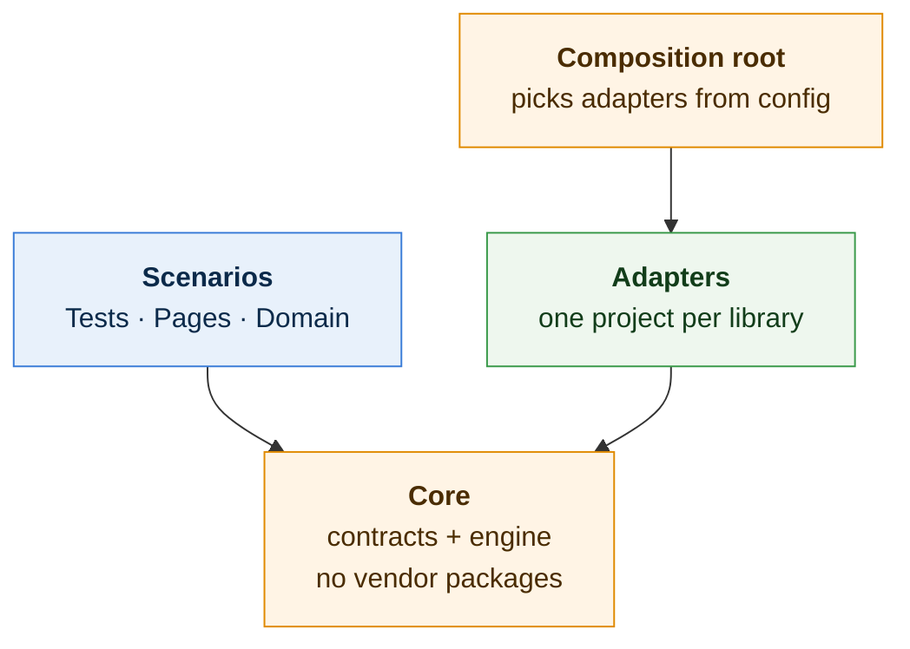

# Plug-and-Play Architecture

**Goal:** every external library the framework uses can be replaced or left out by changing configuration and a project reference, without touching test scenarios. This document is the target design, the current dependency inventory, and the rules for adding a provider. The work is tracked as R39–R48 in [REVIEW.md](REVIEW.md#plug-and-play-roadmap), one phase per pull request.

**Status (2026-11-17):** all phases (0–7) done. The composition root exists (`Core/Composition`: `Framework.Configure`, `IFrameworkPlugin`, `ProviderRegistry`, `providers.json`); logging, results publishing and secrets are selected through it; Elasticsearch has moved out of `Core` into the `Core.Logging.Elastic` adapter; the Appium, Key Vault, RabbitMQ and Kafka code is in separate projects; reporting goes through `ITestReporter` with Allure in the `Core.Reporting.Allure` adapter and a built-in console reporter (phase 2); guardrail tests are in `Tests/Unit/Architecture/AdapterBoundaryTests`. API calls go through `IHttpTransport` with the Playwright adapter and a built-in `HttpClient` transport, both passing the same contract tests (phase 3). Retries go through `IRetryPolicy` with a built-in implementation and the `Core.Resilience.Polly` adapter (phase 4), and web UI goes through the UI contract in `Core/Ui` with the `Core.Ui.Playwright` adapter (phase 5), so **`Core` references no vendor package** (only Microsoft.Extensions.Configuration, an accepted platform dependency) and `Pages` doesn't reference Playwright. Phase 6 added a second web UI driver (`Core.Ui.Selenium`) and put Appium on the same contract (`appium` in `Core.Mobile`), so the mobile suite shares the web page objects. Phase 7 kept xUnit to a thin host layer and moved report labels to framework attributes, so scenario code imports no vendor library at all (checked by `TestHostBoundaryTests`).

---

## 1. Target shape



- **Scenarios** (tests, page objects, domain code) use only framework contracts and helpers. They never import a vendor namespace.
- **`Core`** holds the contracts, the shared models and the engine (`TestRunner`, `CleanupTracker`, `Poll`, settings loading). It references no vendor package.
- **Adapters** implement one contract with one library. Each is its own project under `Core/<Area>/<Vendor>/`, the layout the existing add-ons already use (`Core/Mobile`, `Core/Security/AzureKeyVault`, `Core/Messaging/{Kafka,RabbitMq}`).
- **The composition root** (the test project's `TestRunSetup` module initializer) calls `Framework.Configure(...)` with the plugins of the adapters that project references. The built-in providers (console logging and results, environment secrets) are always registered; `providers.json` (repo root, `PROVIDERS_*` overrides) names which one is used for each contract.

`providers.json` today:

```json
{
  "Logging": "elastic",
  // "ResultsPublisher": "elastic",   // default: same as Logging
  "Reporting": "allure",              // or "console"
  "Http": "playwright",               // or "httpclient"
  "Resilience": "polly",              // or "builtin"
  "Ui": "playwright",                 // web UI driver: or "selenium"
  "MobileUi": "appium",               // mobile UI driver
  "Secrets": [ "environment" ]        // e.g. [ "environment", "azure-keyvault" ]
}
```

```csharp
// Tests/Infrastructure/TestRunSetup.cs (module initializer)
Framework.Configure(new ElasticLoggingPlugin(), new AllureReportingPlugin(), new PollyResiliencePlugin(), new PlaywrightHttpPlugin(), new PlaywrightUiPlugin(), new SeleniumUiPlugin(),
    new AzureKeyVaultPlugin());   // the mobile suite also passes new AppiumUiPlugin()
```

Replacing a library then means: reference the other adapter project, change one value, done.

---

## 2. Contracts

| Area | Contract (in `Core`) | What it covers | Adapters: today → planned | Item |
|---|---|---|---|---|
| Logging | `ILoggingService` (+ `ILoggingProviderFactory`) | log lines per index/category | Console (built in), Elastic (`Core.Logging.Elastic`) | R40 ✓ |
| Results publishing | `IResultsPublisher` (+ `IResultsPublisherFactory`) | one `LogMetadata` document per test | Console (built in), Elastic (`Core.Logging.Elastic`) | R40 ✓ |
| Secrets | `ISecretProvider` | resolve `secret://NAME` | `environment` (built in), `azure-keyvault` (`Core.Security.AzureKeyVault`) | R40 ✓ |
| Reporting | `ITestReporter` (+ `Report.Step` and the `[ReportSuite]` / `[ReportTags]` attributes for tests) | run start, test name, suite labels and tags, parameters, steps, attachments | `console` (built in), `allure` (`Core.Reporting.Allure`) | R39 ✓, R48 ✓ |
| HTTP | `IHttpTransport` (+ `IHttpTransportFactory`) | send a request, return status, headers, body; `HttpRequestException` only when no response arrived | `httpclient` (built in), `playwright` (`Core.Http.Playwright`) | R41 ✓ |
| Resilience | `IRetryPolicy`, `IRetryPolicy<T>` (+ `IRetryPolicyFactory`; `RetryPolicies` names the framework's policies) | run an action with retries for transient exceptions or results | `builtin` (built in), `polly` (`Core.Resilience.Polly`) | R45 ✓ |
| Settings source | none: `SettingsLoader` uses Microsoft.Extensions.Configuration directly (an accepted platform dependency, §6) and keeps `IConfiguration` out of its public API | key/value settings from files and environment | – | R44 (decided 2026-11-17) |
| Web and mobile UI | `IUiDriverFactory` → `IUiDriver` → `IUiSession` (`NavigateAsync`, `TitleAsync`, `Find`); `IElement` (+ `Locate`, `UiRole`); `IElementAssertions` via `Ui.Expect`; `UiException` / `UiAssertionException`; capabilities `IScreenshots`, `ITracing`, `IMobileGestures` via `TryGet<T>`; escape hatch `Native<T>()` | launch, session per test, find, act, wait, assert; optional extras per driver | `playwright` (`Core.Ui.Playwright`: screenshots, tracing), `selenium` (`Core.Ui.Selenium`: screenshots), `appium` (`Core.Mobile`: screenshots, gestures) | R42 ✓, R47 ✓ |
| Messaging | `IMessageListener` *(new; today `MessageCollector<T>` is shared and each listener has its own start method)* | start listening, collect, wait for a match | RabbitMQ, Kafka (add-ons) | R40 |
| Databases | ADO.NET `DbConnection` / `DbProviderFactory` (already provider-neutral) | connection + transaction scope | any ADO.NET provider, chosen by the test project | – |

Contracts describe what the framework needs, not a vendor's API. A contract that would simply repeat every method of one library adds code without making anything replaceable, so it isn't worth writing.

---

## 3. Dependency inventory

Kinds: **move**: in `Core` today, moves to an adapter · **adapter**: already an optional add-on · **host**: runs the tests; isolated, not swapped · **platform**: Microsoft abstraction libraries, used directly · **test-only**: used only by `Tests/Unit`.

| Library (version) | Role | Kind | Where it is used today | Where its types leak | Realistic replacement | Item |
|---|---|---|---|---|---|---|
| Microsoft.Playwright 1.64.1 | browser automation, HTTP for API tests | adapter: `Core.Ui.Playwright` (phase 5), `Core.Http.Playwright` (phase 3) | adapters only; reaches the web test output (incl. `playwright.ps1` and the driver) through them | none in `Core`, `Pages` or tests | Selenium (UI, R47); `HttpClient` for API calls (built in) | R41 ✓, R42 ✓ |
| Allure.Net.Commons / Allure.Xunit 2.15.0 | reporting | adapter (`Core/Reporting/Allure`, phase 2); Allure.Xunit stays in the test projects as the xUnit hook that records each test | `Core.Reporting.Allure` only; test classes use `[ReportSuite]` / `[ReportTags]` (phase 7) | none in scenario code | Console, ReportPortal | R39 ✓, R48 ✓ |
| Elastic.Clients.Elasticsearch 8.12.0 | log and results sink | adapter (`Core/Logging/Elastic`, moved out of `Core` in phase 1) | adapter only | none (behind the logging factories) | OpenSearch, Loki, console | R44 ✓ |
| Polly.Core 8.8.1 | retries | adapter (`Core/Resilience/Polly`, moved out of `Core` in phase 4) | adapter only | none (behind `IRetryPolicyFactory`) | built-in retry | R45 ✓ |
| Microsoft.Extensions.Configuration.* 10.0.12 | settings loading | platform | `Core/Configuration/SettingsLoader` | none (`ResolveSecrets` is internal since phase 4) | none planned; already an abstraction | R44 ✓ |
| Microsoft.Extensions.DependencyInjection | composition root | not used so far | – | – | – | R40: a small `ProviderRegistry` covers named providers; DI only if constructor injection becomes useful |
| Appium.WebDriver 8.0.0, Selenium.WebDriver 4.35.0 | web and mobile automation over WebDriver | adapters: `Core.Ui.Selenium` (`selenium`), `Core.Mobile` (`appium`, builds on `Core.Ui.Selenium`) | adapters only; `Selenium.Support` and `DotNetSeleniumExtras.WaitHelpers` removed in phase 6 | none (mobile pages now use the UI contract) | other WebDriver services | R47 ✓ |
| Azure.Identity 1.21.0, Azure.Security.KeyVault.Secrets 4.12.0 | secrets | adapter (`Core/Security/AzureKeyVault`) | add-on only | none (behind `ISecretProvider`) | AWS Secrets Manager, HashiCorp Vault | – |
| RabbitMQ.Client 7.2.2 | message listener | adapter (`Core/Messaging/RabbitMq`) | add-on only | listener start signature | any broker via `IMessageListener` | R40 |
| Confluent.Kafka 2.16.0 | message listener | adapter (`Core/Messaging/Kafka`) | add-on only | listener start signature | as above | R40 |
| xunit 2.9.3, xunit.runner.visualstudio 2.8.2, Microsoft.NET.Test.Sdk 18.9.0 | test host: discovery, execution, fixtures | host (thin layer, R48) | every test project (imported globally via `<Using Include="Xunit" />`) | test classes: only `[Fact]`, `[Theory]`, `[Trait]` and `Assert`; `IClassFixture` / `IAsyncLifetime` only in fixtures and base classes (checked by `TestHostBoundaryTests`) | xUnit v3, NUnit (a migration of that layer, not a swap) | R48 ✓ |
| coverlet.collector 6.0.2 | coverage | host (CI tooling) | test projects | none | built-in .NET coverage | – |
| Microsoft.Data.Sqlite 10.0.14 | test database for `DbTestScope` | test-only | `Tests/Unit` | none | any ADO.NET provider | – |

---

## 4. Design rules

1. **Scenarios depend on contracts only.** No vendor namespace in `Tests`, `Pages` or `Domain`; vendor code lives in adapters.
2. **`Core` references no vendor package.** Microsoft.Extensions abstractions are the accepted exception.
3. **Contracts describe framework behaviour**, not the vendor's API ("run a step", "send a request", "click this element").
4. **Optional capabilities instead of the lowest common denominator.** The core UI contract stays small; extras are separate interfaces an adapter implements only if it can (`ITracing`, `IScreenshots`, `INetworkControl`, `IMobileGestures`), checked with `session.TryGet<T>(out var capability)`. `session.Native<T>()` is a deliberate escape hatch for rare vendor-only needs, kept visible so the coupling is easy to find.
5. **Assertions are framework code too.** `Ui.Expect(element).ToBeVisible()` is implemented by each adapter: Playwright uses its web-first assertions, others poll with `Poll`.
6. **One way to register and select providers**: a plugin class per adapter, explicit registration in the composition root, selection by name from `providers.json`. No scanning of loaded types.
7. **Every contract has a second implementation** and a shared contract test suite that each adapter passes. One implementation hasn't proven anything is replaceable.
8. **Guardrails are tests.** Architecture tests fail the build if a vendor namespace appears where it shouldn't (R46).

---

## 5. Writing a provider

A provider (adapter) adds one library behind one contract.

1. **Project:** `Core/<Area>/<Vendor>/Core.<Area>.<Vendor>.csproj`, referencing `Core` and the vendor package only (versions in `Directory.Packages.props`). Add its folder to `DefaultItemExcludes` in `Core/Core.csproj`, add it to `ci.slnf`, and put it under the `/Core/<Area>/` folder in `TestAutomationPlatform.slnx`.
2. **Implement the contract** and nothing more. Map vendor errors to framework exceptions (e.g. `ApiException`), never let vendor types appear in a public signature.
3. **Plugin class:** implement `IFrameworkPlugin.Register(ProviderRegistry registry)` and register each provider by name, e.g. `registry.Add<ISecretProvider>("my-vault", () => new MyVaultProvider(...))` (created on first use; names are case-insensitive and must be unique per contract). Reference the adapter from the test projects that may use it, pass its plugin to `Framework.Configure` in their `TestRunSetup`, and select it by name in `providers.json`. Examples: `ElasticLoggingPlugin`, `AzureKeyVaultPlugin`.
4. **Guarantees** every provider of a kind must keep:

   | Kind | Must |
   |---|---|
   | Logging, results publishing, reporting | never fail a test; if the backend is unreachable or the provider unknown, fall back to console and say so once |
   | Secrets | return null for a missing secret (the loader then fails with the setting named); surface access errors |
   | HTTP | no retries of its own (retries are `ApiClient`'s job); return the status for any HTTP response, throw only for transport failures |
   | Resilience | retry only what the predicate marks transient; honour `RetryOptions` |
   | UI | auto-wait or poll before acting; report a missing capability by not implementing its interface, not by throwing |
   | Messaging | leave nothing behind on the broker (no durable queues or committed offsets) |

5. **Tests:** inherit the contract's shared test class in `Tests/Unit` (R46) so the adapter is held to the same behaviour as the others; integration tests that need real infrastructure use `[RequiresEnvironmentFact("VARIABLE")]`.
6. **Docs:** add the library to the inventory above, the add-on to the README structure tree, and a CHANGELOG entry.

---

## 6. Accepted dependencies

- **xUnit is the host**, not a plugin: it discovers and runs tests (R48). Its footprint is deliberately thin and checked by `TestHostBoundaryTests`:
  - test classes use only `[Fact]`, `[Theory]`, `[Trait]` and `Assert` (xUnit's assertions are not wrapped: another runner has the same concepts, and a wrapper would add code without making anything more replaceable);
  - `IClassFixture` / `IAsyncLifetime` appear only in `Fixtures/` and `Infrastructure/` (base classes);
  - the test projects reference no vendor library besides xUnit; `Allure.Xunit` is the package that hooks Allure into xUnit's test lifecycle, so it belongs with the host.
  
  Moving to xUnit v3 or NUnit means changing that layer (attributes, `Assert` namespace, the two fixtures and four base classes, the Allure hook package), not the scenario code, page objects or framework.
- **Microsoft.Extensions.Configuration** is itself an abstraction library. It is used directly in `Core` (settings loading) and not wrapped again; its types are to stay out of public `Core` signatures (R44). Microsoft.Extensions.DependencyInjection would be accepted on the same terms if the composition root ever needs it.
- **ADO.NET** is already the database contract; the test project chooses the provider.


## Adapter failure-path guarantees

Single-element UI actions, reads, visibility checks and scalar assertions reject ambiguous locators. Use `First` explicitly when the first matching element is intended; count and list-text assertions accept collections.

Both HTTP transports honor pre-cancelled and in-flight cancellation. The Playwright transport creates an independently owned context per request, aborts that context on cancellation, and observes the native operation before returning. This preserves concurrent requests and allows reuse after cancellation. Like the HttpClient transport, it does not retain an implicit cookie jar between calls; pass cookies explicitly in request headers.

RabbitMQ startup retains ownership of every acquired connection/channel until the listener is returned and cleans up partial failures. Disposal attempts all channel/connection close and dispose operations while preserving the first error. Kafka headers are projected into the broker-neutral dictionary with last-value-wins semantics and null values mapped to empty strings. `KafkaListener.Completion` exposes fatal worker failures; `WaitForAsync` propagates them instead of waiting for a message timeout. Consumer cleanup runs even when the worker or close operation fails.

### UI selection and HTTP paths

Role locators use case-insensitive accessible-name substring matching and exclude hidden/ARIA-hidden matches. Selenium delegates role and accessible-name computation to the browser's WebDriver accessibility commands, including associated labels, aria-labelledby precedence and explicit role overrides. Role lookup includes transparent elements; actionability is checked when interacting.

`CheckAsync` supports native checkbox/radio inputs and ARIA checkbox/radio elements. It preserves an already checked element and fails for an unsupported target or a checkbox that remains unchecked after interaction. UI contract tests exercise these cases against both browser adapters.

HTTP base URLs are directory paths: both transports append a trailing slash when missing. For example, base `https://host/api` plus `items` resolves to `https://host/api/items`. A root-relative endpoint replaces the base path, and an absolute endpoint replaces the base URL.

Database helpers own a connection until successful handoff. Setup failures dispose acquired connections; scope disposal attempts rollback, transaction disposal and connection disposal independently, preserving the first failure.

### Security guarantees

HTTP transports must return redirects without automatically forwarding request headers/bodies; callers own any explicitly authorized follow-up request. Logging/reporting providers must use sanitized diagnostic text and metadata, and built-in reporters honor `DiagnosticArtifactPolicy`. Shared web infrastructure suppresses captures before collection in restricted mode. See [security controls](SECURITY.md) for scope and limits; binary artifacts are not text-redacted.
