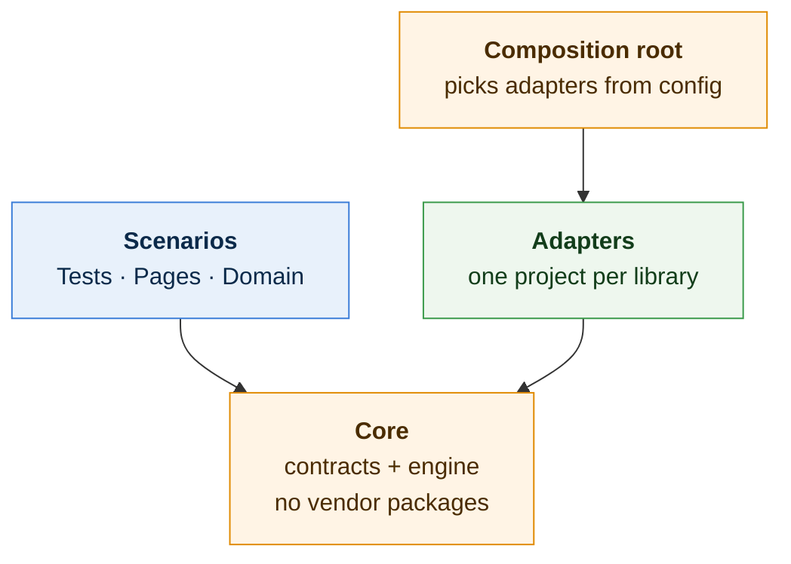

# Plug-and-Play Architecture

**Goal:** every external library the framework uses can be replaced or left out by changing configuration and a project reference, without touching test scenarios. This document is the target design, the current dependency inventory, and the rules for adding a provider. The work is tracked as R39–R48 in [REVIEW.md](REVIEW.md#plug-and-play-roadmap), one phase per pull request.

**Status (2026-11-17):** phases 0 and 1 done. The composition root exists (`Core/Composition`: `Framework.Configure`, `IFrameworkPlugin`, `ProviderRegistry`, `providers.json`); logging, results publishing and secrets are selected through it; Elasticsearch has moved out of `Core` into the `Core.Logging.Elastic` adapter; the Appium, Key Vault, RabbitMQ and Kafka code is in separate projects; first guardrail tests are in `Tests/Unit/Architecture/AdapterBoundaryTests`. Reporting, HTTP, resilience and UI contracts are still target state.

---

## 1. Target shape



- **Scenarios** (tests, page objects, domain code) use only framework contracts and helpers. They never import a vendor namespace.
- **`Core`** holds the contracts, the shared models and the engine (`TestRunner`, `CleanupTracker`, `Poll`, settings loading). It references no vendor package.
- **Adapters** implement one contract with one library. Each is its own project under `Core/<Area>/<Vendor>/`, the layout the existing add-ons already use (`Core/Mobile`, `Core/Security/AzureKeyVault`, `Core/Messaging/{Kafka,RabbitMq}`).
- **The composition root** (the test project's `TestRunSetup` module initializer) calls `Framework.Configure(...)` with the plugins of the adapters that project references. The built-in providers (console logging and results, environment secrets) are always registered; `providers.json` (repo root, `PROVIDERS_*` overrides) names which one is used for each contract.

`providers.json` today (later phases add `Reporting`, `Http`, `Resilience`, `Ui`):

```json
{
  "Logging": "elastic",
  // "ResultsPublisher": "elastic",   // default: same as Logging
  "Secrets": [ "environment" ]        // e.g. [ "environment", "azure-keyvault" ]
}
```

```csharp
// Tests/Infrastructure/TestRunSetup.cs (module initializer)
Framework.Configure(new ElasticLoggingPlugin(), new AzureKeyVaultPlugin());
```

Replacing a library then means: reference the other adapter project, change one value, done.

---

## 2. Contracts

| Area | Contract (in `Core`) | What it covers | Adapters: today → planned | Item |
|---|---|---|---|---|
| Logging | `ILoggingService` (+ `ILoggingProviderFactory`) | log lines per index/category | Console (built in), Elastic (`Core.Logging.Elastic`) | R40 ✓ |
| Results publishing | `IResultsPublisher` (+ `IResultsPublisherFactory`) | one `LogMetadata` document per test | Console (built in), Elastic (`Core.Logging.Elastic`) | R40 ✓ |
| Secrets | `ISecretProvider` | resolve `secret://NAME` | `environment` (built in), `azure-keyvault` (`Core.Security.AzureKeyVault`) | R40 ✓ |
| Reporting | `ITestReporter` *(new)* | test name and parameters, steps, attachments, labels | Allure, Console | R39 |
| HTTP | `IHttpTransport` *(new)* | send a request, return status, headers, body | Playwright `APIRequestContext`, `HttpClient` | R41 |
| Resilience | `IRetryPolicy` *(new)* | run an action with retries for transient failures | Polly, built-in | R45 |
| Settings source | `ISettingsSource` *(new)* | key/value settings from files and environment | Microsoft.Extensions.Configuration | R44 |
| Web and mobile UI | `IUiSession`, `IElement`, `Ui.Expect` *(new)* + capabilities `ITracing`, `IScreenshots`, `INetworkControl`, `IMobileGestures` | navigate, find, act, wait, assert; optional extras per driver | Playwright → Selenium, Appium | R42, R47 |
| Messaging | `IMessageListener` *(new; today `MessageCollector<T>` is shared and each listener has its own start method)* | start listening, collect, wait for a match | RabbitMQ, Kafka (add-ons) | R40 |
| Databases | ADO.NET `DbConnection` / `DbProviderFactory` (already provider-neutral) | connection + transaction scope | any ADO.NET provider, chosen by the test project | – |

Contracts describe what the framework needs, not a vendor's API. A contract that would simply repeat every method of one library adds code without making anything replaceable, so it isn't worth writing.

---

## 3. Dependency inventory

Kinds: **move**: in `Core` today, moves to an adapter · **adapter**: already an optional add-on · **host**: runs the tests; isolated, not swapped · **platform**: Microsoft abstraction libraries, used directly · **test-only**: used only by `Tests/Unit`.

| Library (version) | Role | Kind | Where it is used today | Where its types leak | Realistic replacement | Item |
|---|---|---|---|---|---|---|
| Microsoft.Playwright 1.64.1 | browser automation, HTTP for API tests | move | `Core` (`Api/ApiClient`, `Driver/PlaywrightDriverFactory`, `Resilience`), `Pages` (9 files), `Tests` fixtures, base classes and 6 web test files | `ApiClient.CreateAsync(IPlaywright)`, `SendRawAsync` → `IAPIResponse`; `BasePage(IPage)`, `ILocator`; `Expect(...)` in web tests | Selenium (UI), `HttpClient` (HTTP) | R41, R42, R44 |
| Allure.Net.Commons / Allure.Xunit 2.15.0 | reporting | move | `Core/Testing` (`TestRunner`, `AllureResults`), all three test base classes, 13 test classes | `AllureApi.Step` and suite attributes in every test | Console, ReportPortal, none | R39, R44 |
| Elastic.Clients.Elasticsearch 8.12.0 | log and results sink | adapter (`Core/Logging/Elastic`, moved out of `Core` in phase 1) | adapter only | none (behind the logging factories) | OpenSearch, Loki, console | R44 ✓ |
| Polly.Core 8.8.1 | retries | move | `Core/Resilience`, `Core/Api/ApiClient`, `MobileBasePage` | `RetryPolicies` returns `ResiliencePipeline` | built-in retry | R45, R44 |
| Microsoft.Extensions.Configuration.* 10.0.12 | settings loading | platform (behind `ISettingsSource`) | `Core/Configuration/SettingsLoader` | `SettingsLoader.ResolveSecrets(IConfiguration, …)` | none planned; already an abstraction | R44 |
| Microsoft.Extensions.DependencyInjection | composition root | not used so far | – | – | – | R40: a small `ProviderRegistry` covers named providers; DI only if constructor injection becomes useful |
| Appium.WebDriver 8.0.0, Selenium.WebDriver/Support 4.35.0, DotNetSeleniumExtras.WaitHelpers 3.11.0 | mobile automation | adapter (`Core/Mobile`) | `Core/Mobile` (4 files), mobile pages and base (3 files) | `AppiumDriver`, `IWebElement` in mobile pages | Appium via the shared UI contract | R47 |
| Azure.Identity 1.21.0, Azure.Security.KeyVault.Secrets 4.12.0 | secrets | adapter (`Core/Security/AzureKeyVault`) | add-on only | none (behind `ISecretProvider`) | AWS Secrets Manager, HashiCorp Vault | – |
| RabbitMQ.Client 7.2.2 | message listener | adapter (`Core/Messaging/RabbitMq`) | add-on only | listener start signature | any broker via `IMessageListener` | R40 |
| Confluent.Kafka 2.16.0 | message listener | adapter (`Core/Messaging/Kafka`) | add-on only | listener start signature | as above | R40 |
| xunit 2.9.3, xunit.runner.visualstudio 2.8.2, Microsoft.NET.Test.Sdk 18.9.0 | test host: discovery, execution, fixtures | host | every test project (imported globally via `<Using Include="Xunit" />`) | `[Fact]`, `[Theory]`, `IClassFixture`, `IAsyncLifetime` in tests, fixtures and base classes | xUnit v3, NUnit (a migration, not a swap) | R48 |
| coverlet.collector 6.0.2 | coverage | host (CI tooling) | test projects | none | built-in .NET coverage | – |
| Microsoft.Data.Sqlite 10.0.14 | test database for `DbTestScope` | test-only | `Tests/Unit` | none | any ADO.NET provider | – |

---

## 4. Design rules

1. **Scenarios depend on contracts only.** No vendor namespace in `Tests`, `Pages` or `Domain`; vendor code lives in adapters.
2. **`Core` references no vendor package.** Microsoft.Extensions abstractions are the accepted exception.
3. **Contracts describe framework behaviour**, not the vendor's API ("run a step", "send a request", "click this element").
4. **Optional capabilities instead of the lowest common denominator.** The core UI contract stays small; extras are separate interfaces an adapter implements only if it can (`ITracing`, `IScreenshots`, `INetworkControl`, `IMobileGestures`), checked with `session.TryGet<T>(out var capability)`. `session.Native<T>()` is a deliberate escape hatch for rare vendor-only needs, kept visible so the coupling is easy to find.
5. **Assertions are framework code too.** `Ui.Expect(element).ToBeVisible()` is implemented by each adapter: Playwright uses its web-first assertions, others poll with `Poll`.
6. **One way to register and select providers**: a plugin class per adapter, explicit registration in the composition root, selection by name from `providers.json`. No scanning of loaded types.
7. **Every contract has a second implementation** and a shared contract test suite that each adapter passes. One implementation hasn't proven anything is replaceable.
8. **Guardrails are tests.** Architecture tests fail the build if a vendor namespace appears where it shouldn't (R46).

---

## 5. Writing a provider

A provider (adapter) adds one library behind one contract.

1. **Project:** `Core/<Area>/<Vendor>/Core.<Area>.<Vendor>.csproj`, referencing `Core` and the vendor package only (versions in `Directory.Packages.props`). Add its folder to `DefaultItemExcludes` in `Core/Core.csproj`, add it to `ci.slnf`, and put it under the `/Core/<Area>/` folder in `TestAutomationPlatform.slnx`.
2. **Implement the contract** and nothing more. Map vendor errors to framework exceptions (e.g. `ApiException`), never let vendor types appear in a public signature.
3. **Plugin class:** implement `IFrameworkPlugin.Register(ProviderRegistry registry)` and register each provider by name, e.g. `registry.Add<ISecretProvider>("my-vault", () => new MyVaultProvider(...))` (created on first use; names are case-insensitive and must be unique per contract). Reference the adapter from the test projects that may use it, pass its plugin to `Framework.Configure` in their `TestRunSetup`, and select it by name in `providers.json`. Examples: `ElasticLoggingPlugin`, `AzureKeyVaultPlugin`.
4. **Guarantees** every provider of a kind must keep:

   | Kind | Must |
   |---|---|
   | Logging, results publishing, reporting | never fail a test; if the backend is unreachable or the provider unknown, fall back to console and say so once |
   | Secrets | return null for a missing secret (the loader then fails with the setting named); surface access errors |
   | HTTP | no retries of its own (retries are `ApiClient`'s job); return the status for any HTTP response, throw only for transport failures |
   | Resilience | retry only what the predicate marks transient; honour `RetryOptions` |
   | UI | auto-wait or poll before acting; report a missing capability by not implementing its interface, not by throwing |
   | Messaging | leave nothing behind on the broker (no durable queues or committed offsets) |

5. **Tests:** inherit the contract's shared test class in `Tests/Unit` (R46) so the adapter is held to the same behaviour as the others; integration tests that need real infrastructure use `[RequiresEnvironmentFact("VARIABLE")]`.
6. **Docs:** add the library to the inventory above, the add-on to the README structure tree, and a CHANGELOG entry.

---

## 6. Accepted dependencies

- **xUnit is the host**, not a plugin: it discovers and runs tests. Its types are kept to test attributes, fixtures and base classes so a later runner migration stays contained (R48).
- **Microsoft.Extensions.Configuration** is itself an abstraction library. It is used directly in `Core` (settings loading) and not wrapped again; its types are to stay out of public `Core` signatures (R44). Microsoft.Extensions.DependencyInjection would be accepted on the same terms if the composition root ever needs it.
- **ADO.NET** is already the database contract; the test project chooses the provider.
